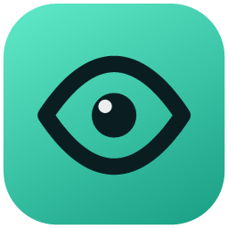
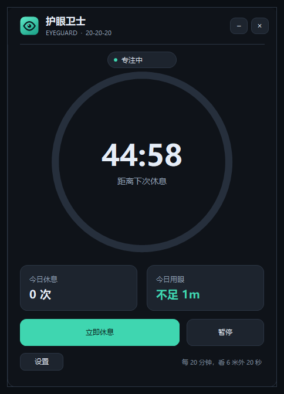
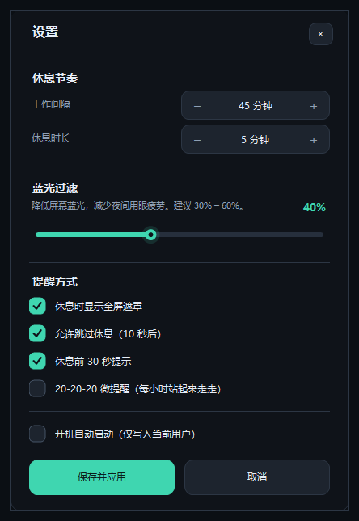
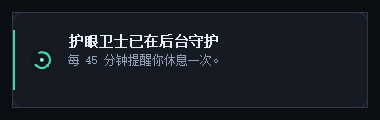
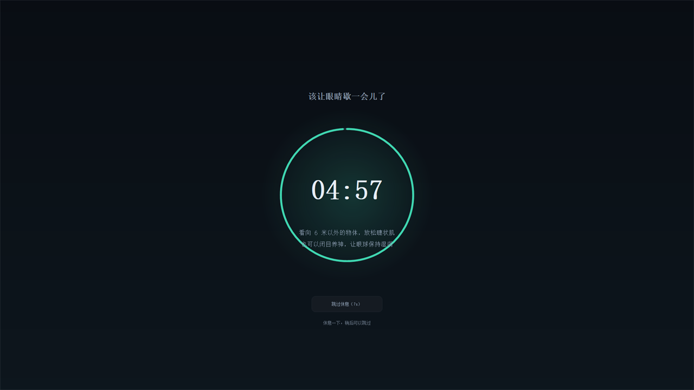

<p align="center"></p>

# EyeGuard

官网: [https://suboy1219.github.io/suboy](https://suboy1219.github.io/suboy)

English | [简体中文](README.md)

A lightweight eye-care tray app for Windows: timed breaks, a full-screen rest overlay, 20-20-20 reminders, and blue-light filtering.

Single executable, about 86 KB. It only needs the built-in .NET Framework 4.x, so you can double-click and run it without installing anything.



## Features

- **Scheduled breaks**: 45 minutes of work, then a 5-minute break by default, with a live countdown ring.
- **Full-screen rest overlay**: covers every monitor and suggests looking into the distance. Skipping unlocks after 10 seconds; `Alt+F4` will not close it.
- **20-20-20 micro reminder**: optional; every 20 minutes a corner toast suggests a 20-second distance break.
- **Blue-light filter**: adjusts the display color temperature through the GPU gamma ramp. Applies system-wide with negligible CPU cost.
- **Tray-first**: closing the window only hides it. The tray menu can pause, start a break, open settings, or quit.
- **Daily stats**: break count and accumulated screen time for today, reset automatically at midnight.
- **Persistent settings**: stored in `%APPDATA%\EyeGuard\config.ini`.
- **Launch at login**: optional, current-user registry only, no administrator rights required.

## Quick start

1. Double-click `eye-guard.exe`.
2. The main panel appears and the default timer starts.
3. To change the rhythm, filter strength, or reminders, click **Settings** (or press `Ctrl+,`).



## Interface

| Area | Description |
| --- | --- |
| Status chip | Focusing / Resting / Paused |
| Center ring | Time until the next break; the outer arc shows progress |
| Breaks today | Completed breaks for the current day |
| Screen time today | Accumulated focus time for the current day |
| Start break | Enters a break immediately; becomes **End break** while resting |
| Pause | Pauses or resumes the timer; paused time is not counted |
| Settings | Opens the settings window; shortcut `Ctrl+,` |

Tray icon:

- Teal: focus timer running
- Amber: resting
- Gray: paused
- Double-click: show the main panel
- Right-click: open the menu, including quit

Corner toasts look like this. They fade out after about 4 seconds, never steal focus, and do not block clicks:



## Settings

| Option | Default | Description |
| --- | --- | --- |
| Work interval | 45 min | Focus time between breaks, 1–180 minutes |
| Break length | 5 min | Duration of each break, 1–60 minutes |
| Blue-light filter | 40% | 0 disables it; 30%–60% is a sensible range at night |
| Full-screen overlay during breaks | On | When off, only a corner toast appears |
| Allow skipping breaks | On | Skipping unlocks after 10 seconds; when off, the full break is mandatory |
| 30-second warning | On | Shows a corner toast before the break starts |
| 20-20-20 micro reminder | Off | Every 20 minutes, suggests a 20-second distance break |
| Launch at login | Off | Writes to `HKCU\Software\Microsoft\Windows\CurrentVersion\Run` |



## About the blue-light filter

It calls Windows `SetDeviceGammaRamp` to modify the GPU output lookup table, the same mechanism used by f.lux and Windows Night Light. It does not overlay a window or capture the screen, so it also applies to full-screen apps, and CPU usage is negligible.

Keep in mind:

- **HDR mode, some discrete GPU drivers, and Remote Desktop** may report success while having no visible effect. This is a system/driver limitation.
- Running it together with Windows Night Light stacks the tint; keep only one enabled.
- If the process is **force-killed** from Task Manager, gamma is not restored and the screen stays warm. Run `eye-guard.exe --reset` once to fix it.
- Normal exit, unhandled exceptions, and logoff all restore the original gamma.

If colors ever look wrong, the tray menu also has **Reset screen color**.

## Command-line options

| Option | Description |
| --- | --- |
| none | Start and show the main panel |
| `--tray` | Start minimized to the tray (used by launch-at-login) |
| `--demo-rest` | Enter a break about 1 second after start, for previewing the overlay |
| `--demo-settings` | Open the settings window about 1 second after start, for screenshots or demos |
| `--selftest` | Headless self-test: config round-trip, value sanitizing, gamma apply/restore; writes `%TEMP%\eyeguard-selftest.log` |
| `--reset` | Restore screen gamma immediately and exit |

The app is single-instance: launching the exe again brings the existing window to the front instead of starting a second copy.

## Build from source

Requirements: Windows with .NET Framework 4.x (`csc.exe` ships with the OS). No SDK installation needed.

```powershell
cd D:\github\eye-guard
powershell -NoProfile -ExecutionPolicy Bypass -File .\build.ps1
```

The script:

1. generates `app.ico` via `make-icon.ps1` if missing;
2. compiles `src\*.cs` with `csc`;
3. writes `eye-guard.exe`.

Self-test:

```powershell
.\eye-guard.exe --selftest
Get-Content "$env:TEMP\eyeguard-selftest.log"
```

## Layout

```
eye-guard/
├─ src/
│  ├─ Program.cs          entry point, single instance, self-test
│  ├─ EyeGuardContext.cs  scheduling, tray, settings application
│  ├─ MainForm.cs         main panel
│  ├─ SettingsForm.cs     settings page and custom controls
│  ├─ OverlayForm.cs      full-screen rest overlay
│  ├─ ToastForm.cs        corner toast
│  ├─ Theme.cs            palette, rounded shapes, buttons, ring, menu renderer
│  ├─ Gamma.cs            gamma-ramp blue-light filter
│  ├─ Config.cs           INI config read/write and sanitizing
│  └─ Native.cs           Win32 interop
├─ docs/                  screenshots (captured with PrintWindow; no desktop content)
├─ build.ps1              build script
├─ make-icon.ps1          icon generator
└─ app.ico / eye-guard.exe
```

## Known limitations

- Exclusive full-screen games may cover the rest overlay; this is inherent to normal top-level windows.
- Brightness control is not implemented, because DDC/CI support varies too much across external monitors.
- No camera access and no screen locking: the app only reminds and tints.
- Launch-at-login stores the current exe path, so re-check the option after moving the folder.

## Example config

`%APPDATA%\EyeGuard\config.ini`:

```ini
WorkMinutes=45
RestMinutes=5
BlueLight=40
MicroBreak=0
MicroMinutes=20
MicroSeconds=20
ShowOverlay=1
AllowSkip=1
AutoStart=0
NotifyBefore=1
TodayRests=3
Today=2026-11-17
TodayWorkSeconds=5420
```

## Check for updates

Right-click the system tray icon and choose **Help → Check for updates** (帮助 → 检测更新). The app compares its version with the latest stable GitHub release and offers to open the release page when an update is available. It also reports missing releases and connection errors.
