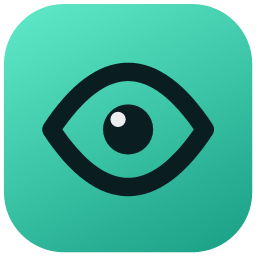
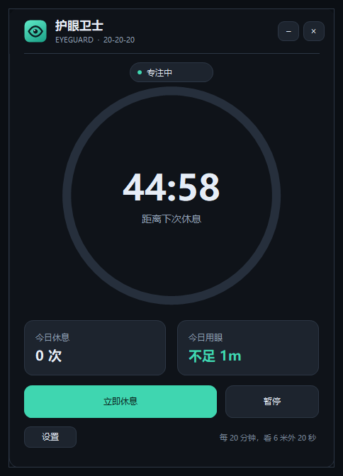
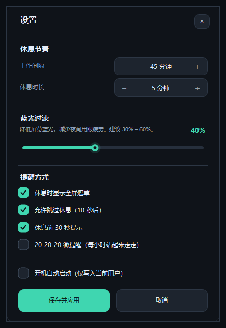
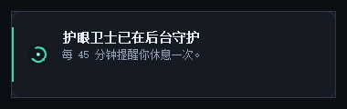
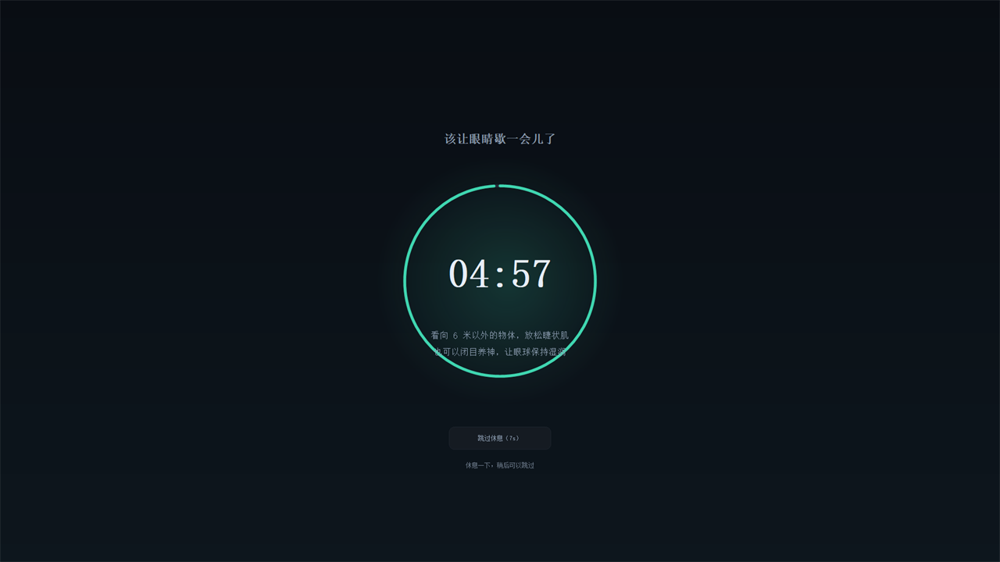

<p align="center"></p>

# 护眼卫士（EyeGuard）

简体中文 | [English](README.en.md)

一个常驻 Windows 托盘的轻量护眼工具：按时提醒休息、全屏休息遮罩、20-20-20 远眺提醒、屏幕蓝光过滤。

单文件程序，约 86 KB，依赖系统自带的 .NET Framework 4.x，双击即用，无需安装。



## 功能

- **定时休息**：默认工作 45 分钟、休息 5 分钟，倒计时圆环实时显示进度。
- **全屏休息遮罩**：休息时覆盖所有显示器，给出远眺提示；10 秒后才允许跳过，`Alt+F4` 关不掉。
- **20-20-20 微提醒**：可选开启，每 20 分钟在角落提示远眺 20 秒。
- **蓝光过滤**：通过显卡 Gamma Ramp 调节色温，全系统生效，几乎不占 CPU。
- **托盘常驻**：关闭窗口不退出，托盘右键可暂停、立即休息、改设置、退出。
- **今日统计**：记录当天休息次数和累计用眼时长，跨天自动清零。
- **配置持久化**：设置写入 `%APPDATA%\EyeGuard\config.ini`。
- **开机自启**：可选，只写当前用户注册表，不需要管理员权限。

## 快速开始

1. 双击 `eye-guard.exe`。
2. 首次运行会显示主面板，按默认节奏开始计时。
3. 需要调整节奏、蓝光强度或提醒方式时，点左下角「设置」（或按 `Ctrl+,`）。



## 界面说明

| 区域 | 说明 |
| --- | --- |
| 状态标签 | 专注中 / 休息中 / 已暂停 |
| 中央圆环 | 距离下次休息的倒计时，外圈为进度 |
| 今日休息 | 当天完成的休息次数 |
| 今日用眼 | 当天累计专注时长 |
| 立即休息 | 立刻进入休息；休息中变为「结束休息」 |
| 暂停 | 暂停/恢复计时，暂停期间不计入用眼时长 |
| 设置 | 打开设置窗口，快捷键 `Ctrl+,` |

托盘图标：

- 青色：正在专注计时
- 橙色：休息中
- 灰色：已暂停
- 双击：打开主面板
- 右键：打开菜单，可退出程序

角落提示长这样，4 秒后自动淡出，不抢焦点、不挡操作：



## 设置项

| 选项 | 默认值 | 说明 |
| --- | --- | --- |
| 工作间隔 | 45 分钟 | 两次休息之间的专注时长，范围 1–180 分钟 |
| 休息时长 | 5 分钟 | 每次休息的时长，范围 1–60 分钟 |
| 蓝光过滤 | 40% | 0 为关闭；夜间或长时间用眼建议 30%–60% |
| 休息时显示全屏遮罩 | 开 | 关闭后只在右下角弹提示，不打断操作 |
| 允许跳过休息 | 开 | 遮罩出现 10 秒后才可跳过；关闭后必须休息完 |
| 休息前 30 秒提示 | 开 | 提前在角落提示，便于收尾 |
| 20-20-20 微提醒 | 关 | 每 20 分钟提示远眺 20 秒 |
| 开机自动启动 | 关 | 写入 `HKCU\Software\Microsoft\Windows\CurrentVersion\Run` |



## 蓝光过滤说明

实现方式是调用 Windows 的 `SetDeviceGammaRamp` 修改显卡输出查找表，和 f.lux、Windows 夜间模式同一原理。它不叠加窗口、不截获画面，因此对全屏应用同样有效，CPU 占用可以忽略。

需要注意：

- **HDR 模式、部分独显驱动、远程桌面**下可能返回成功但实际无效果，这是系统/驱动层面的限制。
- 与 Windows 自带「夜间模式」同时开启会叠加偏色，建议只保留一个。
- 进程被任务管理器**强杀**时不会自动还原 Gamma，屏幕会持续偏暖。此时运行一次 `eye-guard.exe --reset` 即可恢复。
- 正常退出、未处理异常、注销时都会自动还原。

如果发现屏幕颜色不对，托盘右键菜单里也有「重置屏幕色彩」。

## 命令行参数

| 参数 | 作用 |
| --- | --- |
| 无参数 | 启动并显示主面板 |
| `--tray` | 启动后只驻留托盘，供开机自启使用 |
| `--demo-rest` | 启动约 1 秒后直接进入一次休息，便于查看遮罩效果 |
| `--demo-settings` | 启动约 1 秒后直接打开设置窗口，便于截图或演示 |
| `--selftest` | 无界面自检：配置读写、参数清洗、Gamma 应用与恢复；结果写入 `%TEMP%\eyeguard-selftest.log` |
| `--reset` | 立即还原屏幕 Gamma，不启动主程序 |

程序为单实例：重复双击 exe 不会开第二个，而是唤出已在运行的窗口。

## 从源码构建

环境要求：Windows + .NET Framework 4.x（`csc.exe` 随系统提供），无需安装 SDK。

```powershell
cd D:\github\eye-guard
powershell -NoProfile -ExecutionPolicy Bypass -File .\build.ps1
```

脚本会：

1. 若 `app.ico` 不存在，调用 `make-icon.ps1` 生成图标；
2. 用 `csc` 编译 `src\*.cs`；
3. 输出 `eye-guard.exe`。

自检：

```powershell
.\eye-guard.exe --selftest
Get-Content "$env:TEMP\eyeguard-selftest.log"
```

## 目录结构

```
eye-guard/
├─ src/
│  ├─ Program.cs          入口、单实例、自检
│  ├─ EyeGuardContext.cs  计时调度、托盘、设置应用
│  ├─ MainForm.cs         主面板
│  ├─ SettingsForm.cs     设置页与自绘控件
│  ├─ OverlayForm.cs      全屏休息遮罩
│  ├─ ToastForm.cs        右下角提示
│  ├─ Theme.cs            配色、圆角、按钮、圆环、菜单渲染
│  ├─ Gamma.cs            Gamma Ramp 蓝光调节
│  ├─ Config.cs           INI 配置读写与参数清洗
│  └─ Native.cs           Win32 互操作
├─ docs/                  界面截图（均由 PrintWindow 抓取窗口内容，不含桌面）
├─ build.ps1              构建脚本
├─ make-icon.ps1          图标生成
└─ app.ico / eye-guard.exe
```

## 已知限制

- 独占全屏游戏可能盖住休息遮罩，这是普通窗口的固有边界。
- 亮度调节未实现，外接显示器的 DDC/CI 兼容性差异太大。
- 不读取摄像头、不锁屏，只做提醒和色彩调节。
- 开机自启记录的是当前 exe 路径，移动文件后需要在设置里重新勾选一次。

## 配置示例

`%APPDATA%\EyeGuard\config.ini`：

```ini
WorkMinutes=45
RestMinutes=5
BlueLight=40
MicroBreak=0
MicroMinutes=20
MicroSeconds=20
ShowOverlay=1
AllowSkip=1
AutoStart=0
NotifyBefore=1
TodayRests=3
Today=2026-11-17
TodayWorkSeconds=5420
```
